<!--
  Profile README for github.com/andravall
  All visuals are hand-built SVGs in ./assets (no external requests, no scripts).
  Technology logos: Simple Icons (CC0); each mark is a trademark of its owner.
  The four Connect cards must stay on ONE line with no spaces between the tags:
  each image is exactly 25% wide and carries its own gap, so any whitespace would wrap the row.
  The Website card is intentionally not a link until the site exists.
-->

  

 

  

 

  

