<!--
  Profile README for github.com/andravall
  All visuals are hand-built SVGs in ./assets (no external requests, no scripts).
  Technology logos: Simple Icons (CC0) and Devicon (MIT); each mark is a trademark of its owner.
  Connect is one panel cut into five images (header strip + four 25% card slots) so each
  card can be its own link. Keep the whole 
 on ONE line with no spaces between tags, and
  keep align="top" on every image: it removes the inline gap so the slices meet seamlessly.
-->

  

 

  

 

 

